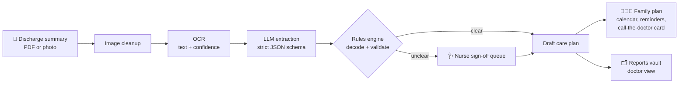

<div align="center">

# 🏠 Going Home Right

### Hospital discharge sheet in. A care plan the whole family can follow, out.


**Team Redemption** · aayu 2026 (DevAarambh) · Problem Statement **T03**

</div>

---

## Contents

1. [The story](#1-the-story)
2. [The problem](#2-the-problem)
3. [Our solution](#3-our-solution)
4. [How it works](#4-how-it-works)
5. [Features: what each does and why it matters](#5-features-what-each-does-and-why-it-matters)
6. [Safety by design](#6-safety-by-design)
7. [Try it in 3 minutes (demo walkthrough)](#7-try-it-in-3-minutes-demo-walkthrough)
8. [Tech stack and architecture](#8-tech-stack-and-architecture)
9. [Getting started](#9-getting-started)
10. [Privacy, ethics and limitations](#10-privacy-ethics-and-limitations)
11. [Impact](#11-impact)
12. [Roadmap](#12-roadmap)
13. [References](#13-references)
14. [Team](#14-team)

---

## 1. The story

**Kamla Devi is 68.** After a heart admission, she is finally discharged.

At the billing counter, a busy nurse explains the discharge sheet to her son in about thirty seconds:

> *"Tab Ecosprin 75 OD, Tab Metoprolol 25 BD, review after 7 days, SOS if breathlessness."*

He nods. He is thinking about the bill, the ambulance, the bags. He folds the paper and puts it in his pocket.

At home, it is **her daughter-in-law** who gives the medicines. She was never at the hospital. She has never heard what *OD*, *BD* or *SOS* mean. She looks at the sheet, guesses, and does her best.

- **Day 1:** it goes fine.
- **Day 2:** the family is tired, and one tablet is given twice because two people each thought it was their turn.
- **Day 3:** another tablet is missed entirely. Nobody notices.
- **Day 7:** the follow-up date passes. Nobody notices that either.

Nobody was careless. Nobody was told clearly. The hospital explained the plan **once, verbally, in shorthand, to the wrong person**, and then the patient went home to a place where there is no nurse.

**Going Home Right exists for the daughter-in-law.** It takes the same sheet and turns it into a plan she can follow without a medical degree: what to give, when to give it, what to watch for, and when to call the doctor. It reminds her when it is time. It remembers the follow-up date so the family does not have to.

> Recovery does not end at the discharge desk. It starts there.

---

## 2. The problem

Discharge is the most dangerous handover in a patient's journey, and it is handled with a piece of paper.

| What happens today | What goes wrong |
|---|---|
| Instructions are explained once, verbally, in a rush | The person who gives the medicines at home often was not there |
| The sheet is written in clinical shorthand (OD, BD, TDS, SOS) | Families do not know what it means, so they guess |
| Several medicines, several timings | Doses are doubled or missed |
| Follow-up is a line of text on page 3 | The date passes unnoticed |
| Papers live in a crumpled folder | At the next visit the doctor spends the consultation reading paperwork |

**The scale of the wider problem is well documented:**

- The World Health Organization found that in developed countries only **about 50%** of patients with chronic diseases take their medicines as prescribed, and that adherence is lower in developing countries. For hypertension medicines, the WHO reported **27% in Gambia, 43% in China and 51% in the USA**.
- WHO's *Medication Without Harm* initiative estimates that medication errors cost around **US$ 42 billion a year** worldwide.

*(Sources in [References](#13-references).)*

---

## 3. Our solution

**Going Home Right** converts a hospital discharge summary (a PDF or a photo) into a simple daily care plan for the family.

| Before | After |
|---|---|
| `Tab Ecosprin 75 OD` | **Morning:** Ecosprin 75 mg, once a day |
| `Tab Metoprolol 25 BD` | **Morning and Night:** Metoprolol 25 mg, twice a day |
| `Review after 7 days` | **Check-up reminder** set for the right date |
| `SOS if breathlessness` | ⚠️ **Flagged for a nurse:** no medicine is named, so we do not guess |

**Four ideas drive the design:**

1. **Start from the document.** No hospital integration is needed. Upload the sheet and go.
2. **Built for the family, not just the patient.** The person giving the medicines is the real user.
3. **Safe by design.** The AI reads the paper. Rules make the decisions. A nurse confirms anything unclear. Nothing is guessed.
4. **Continuity.** The documents stay with the patient, so the next doctor sees the full picture in seconds.

---

## 4. How it works



1. **Capture.** Upload a PDF or take photos of the discharge summary.
2. **Read.** The image is cleaned up (rotation, contrast), then text is extracted with OCR.
3. **Structure.** An LLM turns the text into strict, validated fields: medicines, strengths, frequencies, follow-up, warning signs, diet and physiotherapy advice. Every field keeps a link to the exact source line.
4. **Verify.** A rules engine decodes shorthand, builds the schedule and validates every field. Anything it cannot be sure about is flagged.
5. **Approve.** A nurse reviews flagged items. The plan only goes live to the family after that.
6. **Deliver.** The family gets the daily schedule, reminders, the check-up date and the "call the doctor if..." card. The original documents are stored for the doctor.

---

## 5. Features: what each does and why it matters

### F1. Discharge scanner (PDF and photo extraction)

**What it does.** Accepts a PDF or one or more photos of a discharge summary, including crumpled or slightly blurred pages. Text PDFs are parsed directly. Photos and scanned PDFs are cleaned up and read with OCR. The system then extracts medicines (name, strength, form), frequency, duration, follow-up, warning signs, diet advice, physiotherapy advice and allergies.

**Why it matters.** Everything starts with the paper. Today, the information is locked inside a sheet that families cannot read and a verbal explanation they cannot remember. If this step fails, nothing after it works. This feature removes the single biggest barrier: **the family never has to interpret the sheet themselves.** Every extracted field links back to its source line, so anyone can check where it came from.

---

### F2. Medicine calendar (morning, afternoon, night)

**What it does.** Turns every medicine into a clear daily schedule with Morning, Afternoon and Night slots, and a week view. Each dose can be ticked as taken or skipped. Shorthand such as OD and BD is decoded by rules, not by AI.

**Why it matters.** The failure in Kamla Devi's story was not knowledge, it was **coordination**: one tablet doubled because two people each thought it was their turn, another missed because nobody had the full picture. A shared calendar answers the question *"has this been given yet?"* in one glance. That directly addresses the doubled and missed doses that make non-adherence one of the most expensive problems in healthcare.

---

### F3. Reminders at medicine time

**What it does.** Sends a reminder at every dose time, with the medicine name and strength, so the right tablet is picked. If a dose is not confirmed within a grace window, a follow-up nudge goes to the caregiver. Slot times can be adjusted to the patient's routine.

**Why it matters.** People forget, especially when caring for someone while managing a household. A schedule is only useful if it speaks up at the right moment. Reminders convert a plan into a **habit**, and they are what keep a family on track on day 3, day 10 and day 30, when the hospital instructions have faded from memory.

---

### F4. Next check-up date and reminder

**What it does.** Reads the follow-up instruction ("review after 7 days"), converts it into a real date, and reminds the family ahead of time and on the day. The date also appears on the doctor's view.

**Why it matters.** In the story, the follow-up date passed in silence. A missed review means the doctor never gets to check how recovery is going or adjust treatment. This feature protects **continuity of care**, the link between the hospital stay and the recovery that follows it.

---

### F5. Reports keeper (discharge documents, visible to the doctor)

**What it does.** Stores the original discharge images and PDFs securely against the patient. The family can share a read-only, time-limited link or QR code with a doctor, who sees the original document beside the extracted medicine timeline.

**Why it matters.** Picture the next OPD visit: the patient arrives with a plastic folder of crumpled prescriptions, and the doctor spends most of a two-minute consultation reading paperwork, sometimes missing something critical like an allergy on page four. The Reports keeper puts the full history in front of the doctor **in seconds**, so the consultation time goes to the patient, not the paper.

---

### F6. Care without a personal caretaker

**What it does.** Packages the plan so that any family member can look after routine recovery at home: plain-language steps, a daily schedule, and a **"Call the doctor if..."** card that lists the warning signs written in the discharge summary, with a one-tap call button. Several relatives can be invited to the same plan, so care does not depend on whoever happened to be at the hospital.

**Why it matters.** Many families feel they must hire a paid caretaker just because they are afraid of getting something wrong. For routine medicine management, much of that fear is really a **lack of clear instructions**. When the plan is simple and the warning signs are explicit, families gain confidence, and a household can often manage without extra paid help. This is about dignity and affordability. *(It supports families. It does not replace clinical care, and the card only shows warning signs that appear in the patient's own documents.)*

---

### F7. Food check: is what they eat what the doctor advised?

**What it does.** Reads diet instructions from the summary (for example "low salt" or "no sugar") and stores them as rules. The family logs meals, and the app shows when something falls outside the doctor's advice, with the source line.

**Why it matters.** Diet is part of treatment, especially after a heart event or with diabetes, yet it is the part most easily forgotten at home. This feature keeps the family aligned with **what the doctor actually prescribed**. It reports against the doctor's instructions only. It never invents its own diet advice.

---

### F8. Physiotherapy arrangement

**What it does.** When the summary mentions physiotherapy, or the patient has a physical injury, the app offers an "Arrange physiotherapy" action. The family picks home visit or clinic and a preferred time, sends a request, and the sessions appear on the same calendar as the medicines.

**Why it matters.** Recovery from injury or surgery depends on rehabilitation, and it is often arranged late or forgotten altogether because the family is busy with medicines and logistics. Putting physiotherapy **on the same calendar** makes it part of the recovery plan, not an afterthought.

---

### F9. Nurse sign-off queue (the safety valve)

**What it does.** Anything the system cannot read or interpret with certainty lands in a queue for a nurse, who sees the source line, the system's reading and edit controls. The plan only goes live to the family once every flagged item is approved or removed, and the approver and time are recorded.

**Why it matters.** In healthcare, a confident wrong answer is worse than no answer. This is what lets a family trust the plan. Examples we flag: a medicine with no readable dose, **"SOS" with no medicine named**, a code like "OD" that could mean something else in another context, conflicting instructions, and unknown abbreviations.

---

### Feature importance at a glance

| Feature | Problem it solves | Who benefits most |
|---|---|---|
| F1 Discharge scanner | Family cannot read or remember the instructions | Family caregiver |
| F2 Medicine calendar | Doubled and missed doses | Patient, caregiver |
| F3 Reminders | Forgetting, especially over weeks | Patient, caregiver |
| F4 Check-up tracker | Follow-up passes unnoticed | Patient, doctor |
| F5 Reports keeper | Doctor wastes consultation time on paperwork | Doctor, patient |
| F6 Care without a caretaker | Fear and cost of paid help for routine care | Family |
| F7 Food check | Diet advice ignored at home | Patient |
| F8 Physiotherapy arrangement | Rehabilitation arranged late or forgotten | Patient |
| F9 Nurse sign-off | Wrong or guessed instructions | Everyone |

---

## 6. Safety by design

> **AI reads. Rules decide. Humans sign off.**

| Who | Responsibility |
|---|---|
| **AI** (OCR + LLM) | Reads the page, extracts fields into a strict schema, writes plain-language wording |
| **Rules engine** | Decodes shorthand, builds the schedule, calculates dates, validates every field |
| **Nurse** | Confirms anything flagged; the plan cannot go live without it |

**Shorthand the rules engine understands (initial set):**

| Code | Meaning | Default slots (editable) |
|---|---|---|
| OD | Once a day | Morning |
| BD / BID | Twice a day | Morning, Night |
| TDS / TID | Three times a day | Morning, Afternoon, Night |
| QID | Four times a day | Four-slot pattern |
| HS | At bedtime | Night |
| SOS / PRN | Only if needed | Shown as an as-needed item, not scheduled |
| AC / PC | Before / after meals | Adds a meal note to the slot |

Default slots are conventions, so a nurse can change them. **Unknown codes are flagged, never inferred.**

**What Going Home Right never does:**

- ❌ It never diagnoses a condition.
- ❌ It never suggests a new medicine or changes a dose.
- ❌ It never fills in a missing dose or frequency.
- ❌ It never shows an unapproved item to the family as final.
- ❌ It never adds warning signs that are not in the patient's own documents.

Every plan field is traceable to a source line and an audit record, and every plan screen ends with: *"Confirm with your doctor or nurse."*

---

## 7. Try it in 3 minutes (demo walkthrough)

Use the synthetic sample discharge sheet (no real patient data) based on Kamla Devi's story.

1. **Upload** the sample discharge summary (PDF or photo).
2. **Watch the draft plan appear.** Ecosprin 75 mg shows once a day in the Morning, and Metoprolol 25 mg twice a day in Morning and Night. `OD` and `BD` are decoded by rules.
3. **See the safety valve work.** The line `SOS if breathlessness` is flagged: no medicine is named, so the app does not guess.
4. **Switch to the nurse view.** Review the flagged line, see the source text, approve or edit it. The plan goes live.
5. **Open the family view.** See the Morning / Afternoon / Night schedule, tick a dose, and see the "Call the doctor if..." card.
6. **Trigger a reminder.** A dose scheduled a couple of minutes ahead sends a push notification; tapping it opens the confirm screen.
7. **Check the follow-up.** "Review after 7 days" appears as a real date with a reminder.
8. **Open the doctor view.** The original discharge document sits beside the medicine timeline, shareable through a read-only link.
9. **Try the extras.** Log a meal that conflicts with the diet advice, and request a physiotherapy session.

---

## 8. Tech stack and architecture

| Layer | Choice | Why |
|---|---|---|
| Frontend | **Next.js** (App Router), TypeScript, Tailwind CSS | One codebase for UI and API, fast to build and demo |
| PWA | Web app manifest, service worker, Web Push | Installs on any phone and delivers reminders without an app store |
| API | Next.js Route Handlers on **Node.js**, validated with zod | Simple, typed request handling |
| Background worker | Node.js with BullMQ + Redis | OCR, LLM extraction and reminder scheduling run off the request path |
| Database | PostgreSQL (Supabase) with Prisma | Relational data suits plans, doses and audit logs |
| Auth | Supabase Auth with roles: patient, caregiver, nurse, doctor | Role-based access is core to nurse and doctor flows |
| Storage | Supabase Storage (private buckets, signed URLs) | Discharge images and PDFs |
| Image prep | sharp | Rotate, resize, boost contrast before OCR |
| OCR | Cloud OCR (e.g. Google Cloud Vision) with Tesseract.js fallback | Better results on crumpled photos, with an offline option |
| LLM | LLM API with JSON-schema output | Extraction and plain-language wording only |
| Testing | Vitest (rules engine), Playwright (end to end) | The rules engine is the safety core, so it gets the most tests |

**Core data model:** `users`, `patients`, `patient_members`, `documents`, `extractions`, `plan_items` (with `source_text`, `confidence`, `status`), `doses`, `nurse_reviews`, `reminders`, `meal_logs`, `physio_requests`, `audit_log`.

**Key endpoints:**

| Endpoint | Purpose |
|---|---|
| `POST /api/documents` | Upload a discharge file and start extraction |
| `GET /api/patients/:id/plan` | Fetch the current plan |
| `GET /api/review/queue` | Nurse: list flagged items |
| `POST /api/review/:itemId` | Nurse: approve, edit or remove an item |
| `POST /api/doses/:id/confirm` | Mark a dose taken or skipped |
| `POST /api/share` | Create an expiring doctor link |
| `POST /api/meals` | Log a meal and check it against diet rules |
| `POST /api/physio/requests` | Request a physiotherapy session |

---

## 9. Getting started

**Prerequisites:** Node.js 18+, a PostgreSQL database (Supabase works), Redis, and API keys for your OCR and LLM providers.

```bash
# 1. Clone and install
git clone <repo-url>
cd going-home-right
npm install

# 2. Configure environment
cp .env.example .env.local

# 3. Set up the database
npx prisma migrate dev

# 4. Run the web app
npm run dev

# 5. In a second terminal, run the background worker
npm run worker
```

**Environment variables (names may differ in your setup):**

| Variable | Purpose |
|---|---|
| `DATABASE_URL` | PostgreSQL connection string |
| `SUPABASE_URL`, `SUPABASE_ANON_KEY` | Auth and storage |
| `REDIS_URL` | Job queue for the worker |
| `OCR_API_KEY` | Cloud OCR provider |
| `LLM_API_KEY` | LLM provider for extraction |
| `VAPID_PUBLIC_KEY`, `VAPID_PRIVATE_KEY` | Web Push notifications |

Open `http://localhost:3000`, sign in with a demo role (family, nurse or doctor), and follow the [demo walkthrough](#7-try-it-in-3-minutes-demo-walkthrough).

---

## 10. Privacy, ethics and limitations

- **Sensitive data.** Health information is personal and sensitive. We collect explicit consent, keep only what is needed, encrypt data in transit and at rest, use private storage with signed URLs, and keep an audit trail. We align our approach with India's Digital Personal Data Protection Act, 2023, and any real-world pilot needs proper legal review.
- **Demo data is synthetic.** The demo uses made-up discharge sheets, never real patient information.
- **Not a medical device.** Going Home Right organises and explains what the hospital has already prescribed. It does not diagnose, prescribe or replace a doctor, nurse or pharmacist.
- **Honest limitations.** OCR can struggle with very poor handwriting or severely damaged photos. That is exactly why uncertain items go to a nurse instead of being guessed. Default dose timings are conventions that a nurse can change. The physiotherapy directory in the demo is mocked.

---

## 11. Impact

| For | Benefit |
|---|---|
| **Patients** | Fewer missed or doubled doses, and a safer recovery at home |
| **Families** | One clear plan, no matter who was at the hospital, and less fear of getting it wrong |
| **Doctors** | Past discharge records ready at the next visit, so consultation time goes to the patient |
| **Hospitals** | Better handover at discharge and fewer avoidable medication errors |
| **Society** | Dignity and safety for elderly patients, less need for paid help for routine care, and paperless records instead of lost printouts |

**Metrics we would track (to be measured, not assumed):** share of doses confirmed on time, extraction accuracy on a test set of sample sheets, share of ambiguous test lines correctly flagged rather than guessed, follow-up visits kept versus reminded, and time for a doctor to find a past document.

---

## 12. Roadmap

- **Now (hackathon prototype):** scanner, calendar, reminders, check-up tracker, reports keeper, nurse sign-off, food check, physiotherapy request.
- **Next (pilot):** a nurse dashboard for discharge desks, a QR code on the discharge sheet, Hindi and other regional languages, real physiotherapy partners, and SMS or WhatsApp reminders as a fallback to push.
- **Later (scale):** health-record linking through India's ABDM ecosystem, pharmacy and physiotherapy partner networks, and richer caregiver sharing.

---

## 13. References

1. World Health Organization (2003). *Adherence to Long-Term Therapies: Evidence for Action.* [WHO news release](https://www.who.int/news/item/01-07-2003-failure-to-take-prescribed-medicine-for-chronic-diseases-is-a-massive-world-wide-problem)
2. World Health Organization (2017). *Global Patient Safety Challenge: Medication Without Harm.* [WHO news release](https://www.who.int/news-room/detail/29-03-2017-who-launches-global-effort-to-halve-medication-related-errors-in-5-years)
3. Problem Statement T03, *Going Home Right* (aayu 2026, DevAarambh).

---

## 14. Team

**Team Redemption** · aayu 2026 · Problem Statement T03

---

<div align="center">

*Going Home Right: because recovery should not end at the discharge desk.*

</div>
